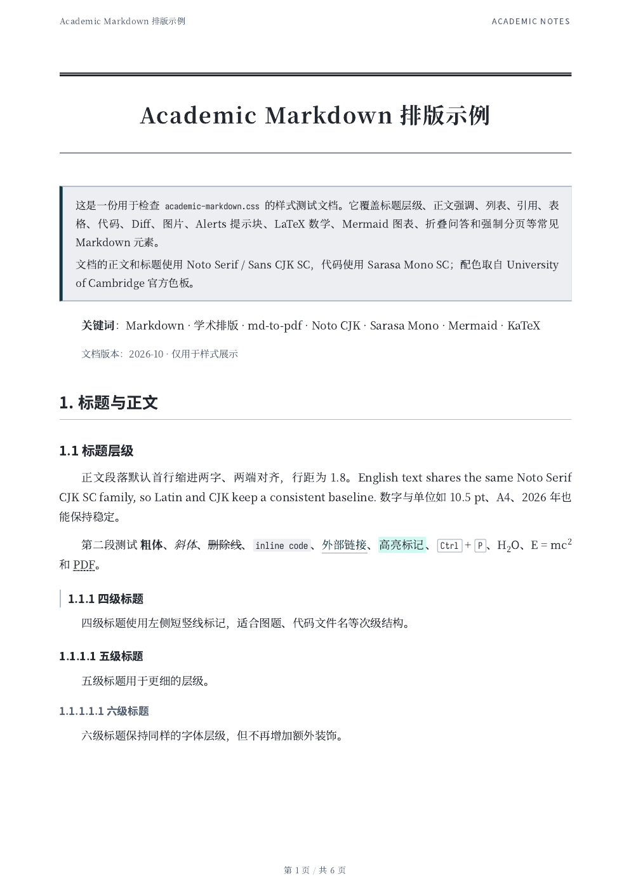
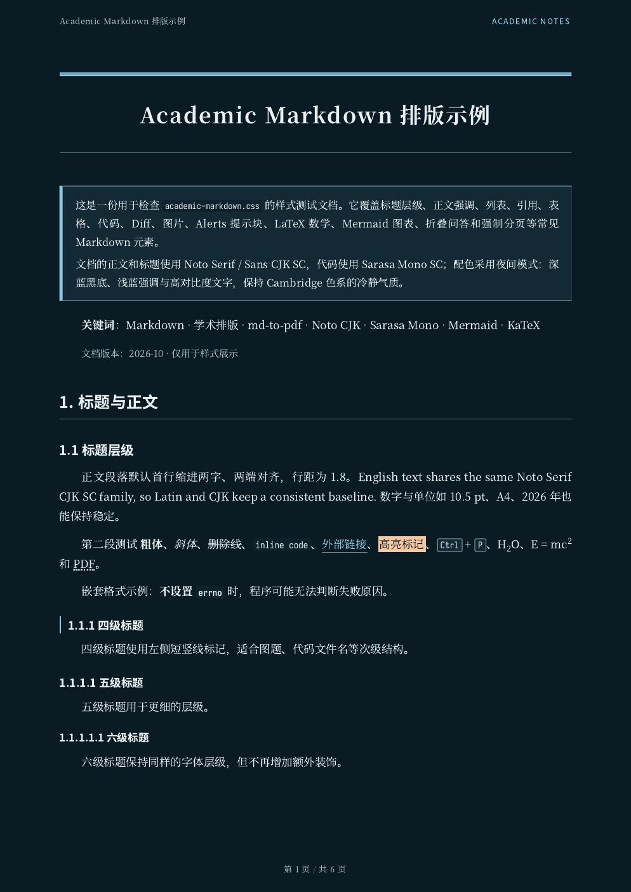
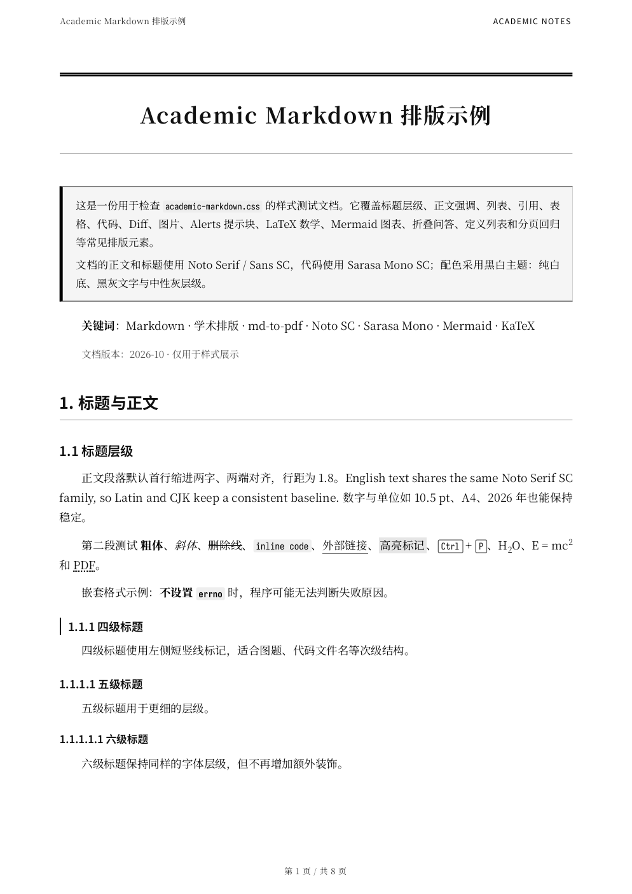

# Academic Markdown CSS

Chinese-first A4 academic PDF themes · light / night / monochrome

[English](README.en.md) · [中文](README.md)

| Light | Night | Monochrome |
|:--:|:--:|:--:|
| [](example.pdf) | [](example-night.pdf) | [](example-mono.pdf) |

[Example Markdown](example.md) · [Light PDF](example.pdf) · [Night PDF](example-night.pdf) · [Monochrome PDF](example-mono.pdf)

> This is a Chinese-first academic typesetting theme and configuration for [md-to-pdf](https://github.com/simonhaenisch/md-to-pdf): CSS, fonts, pagination, running headers, and three palettes. It is not a Markdown editor or a full LaTeX engine.

| Area | What you get |
|---|---|
| Layout | A4, 10.5 pt body text, 1.8 line height, first-line indentation, justified text, three-line tables, repeated table headers, running headers, page numbers, PDF bookmarks |
| Content | Code highlighting, diff blocks, GitHub alerts, KaTeX, Mermaid, `<details>`, task lists, definition lists |
| Themes | Light / night / monochrome, all checked against WCAG 2.2 AA |
| Output | CID TrueType font embedding, inlined KaTeX fonts, height-based pagination for tall tables and code blocks |

Section 11 of `example.md` is a page-by-page regression checklist covering font embedding, pagination, CJK emphasis, punctuation, and code line width.

## Quick Start

```bash
npm install
npm run build
```

`npm run build` renders the light version of `example.md` to `example.pdf`. Night and monochrome examples:

```bash
npm run build:night  # example-night.pdf
npm run build:mono   # example-mono.pdf
```

## Rendering Your Own Document

```bash
npm run render -- path/to/your-file.md
npm run render:night -- path/to/your-file.md
npm run render:mono -- path/to/your-file.md
```

The PDF is written next to the Markdown file. `md-to-pdf` 5.2.5 has no `--dest`; use the Node API to write elsewhere (see `scripts/build-night.js`).

If the Markdown file is outside this project, point `--basedir` at the directory that contains it. KaTeX fonts are inlined, so `--basedir` no longer breaks maths fonts; images and other relative assets still need to live under that directory.

In a non-interactive WSL/CI shell, load nvm first:

```bash
source "$HOME/.nvm/nvm.sh"
npm run render -- path/to/your-file.md
```

The running-header label defaults to `ACADEMIC NOTES`; override it per course or project:

```bash
MD_HEADER_LABEL="Robotics" npm run render -- path/to/your-file.md
```

The first `h1` becomes the document title. Override it with frontmatter:

```markdown
---
document_title: My document title
---
```

## Themes

| Theme | Build | Render | Background | Body | Accent / links |
|---|---|---|---|---|---|
| Light / default | `npm run build` | `npm run render` | `#ffffff` | `#232830` | `#133844` |
| Night | `npm run build:night` | `npm run render:night` | `#0b1b23` | `#e8f0f4` | `#8ecae6` |
| Monochrome | `npm run build:mono` | `npm run render:mono` | `#ffffff` | `#111111` | `#000000` |

Night and monochrome only add a colour layer; layout, fonts, and pagination are shared with the light theme.

## Requirements and Fonts

- Node.js >= 22.12
- Noto Serif SC / Noto Sans SC: static TTF, weights 400 / 600 / 700 recommended
- Noto Sans: fallback for Greek letters and superscripts, usually provided by `fonts-noto-core`
- Sarasa Mono SC: code font, TTF

**Use static TTF.** Variable fonts such as `NotoSerifSC[wght].ttf` are still embedded as Type 3 by Chrome/Skia; so are the CFF/OTC fonts from `fonts-noto-cjk`. Type 3 roughly doubles the PDF size and can hurt print preflight and some RIPs.

```bash
css=$(curl -fsSL 'https://fonts.googleapis.com/css2?family=Noto+Serif+SC:wght@400;600;700&family=Noto+Sans+SC:wght@400;600;700')
mkdir -p "$HOME/.local/share/fonts/noto-sc-ttf"
printf '%s\n' "$css" | grep -o 'https://[^)]*\.ttf' | while read -r url; do
  curl -fsSL "$url" -o "$HOME/.local/share/fonts/noto-sc-ttf/$(basename "$url")"
done
fc-cache -f
```

Download the TTF build of Sarasa Mono SC from [Sarasa Gothic Releases](https://github.com/be5invis/Sarasa-Gothic/releases), then install and refresh the cache:

```bash
sudo cp SarasaMonoSC-*.ttf /usr/local/share/fonts/
sudo fc-cache -f
```

Verify the fonts:

```bash
fc-match "Noto Serif SC"
fc-match "Noto Sans SC"
fc-match "Noto Sans"
fc-list | grep -i "Sarasa Mono SC"
```

## Customisation

- `academic-markdown.css`: base layout and light theme; font stacks live in `--font-serif`, `--font-sans`, and `--font-mono`
- `academic-markdown-night.css` / `academic-markdown-mono.css`: night / monochrome colour layers
- `md-to-pdf.config.js`: page margins (`PAGE`), header/footer, Mermaid, pagination threshold
- `md-to-pdf.night.config.js` / `md-to-pdf.mono.config.js`: theme entry points

Table column widths are allocated automatically. To fix a column, override a specific table:

```css
table:nth-of-type(2) th:nth-child(1) { width: 12%; }
table:nth-of-type(2) th:nth-child(2) { width: 40%; }
table:nth-of-type(2) th:nth-child(3) { width: 48%; }
```

Avoid enabling `table-layout: fixed` globally; it makes every table use equal-width columns.

## Extended Syntax

| Syntax | How to write it | Notes |
|---|---|---|
| Alerts | `> [!NOTE]` | NOTE / TIP / IMPORTANT / WARNING / CAUTION |
| KaTeX | `$...$` / `$$...$$` | Inline and display maths; not full LaTeX |
| Diff | `diff` code block | `+` / `-` lines are highlighted separately |
| Mermaid | `mermaid` code block | Rendered to SVG inside Chromium |
| Collapsible Q&A | `<details><summary>` | Expanded automatically for printing |

See [example.md](example.md) for complete runnable examples.

## Accessibility

- Body-text contrast: light 14.81:1, night 15.23:1, monochrome 18.88:1
- Links keep an underline; alerts have text labels, and diff blocks keep `+` / `-`, so information is not conveyed by colour alone
- Run `npm run check:contrast` to check the key night and monochrome colour pairs

## Notes

- Mermaid, KaTeX, and Alerts are processed locally; no CDN is required.
- Night is intended for screen reading. Use light or monochrome for paper. Monochrome suits single-colour printing, photocopying, and contexts where colour would distract.
- Short tables stay on one page where possible; tables, code blocks, and quotes taller than about 40% of the content area may span pages.
- Code blocks use `pre-wrap`; Chromium does not apply a hanging indent to soft-wrapped lines, so keep code lines under 100 characters where possible.
- The `fixCjkEmphasis` preprocess hook fixes strong emphasis next to full-width punctuation. It only inserts zero-width characters inside the delimiters; code blocks and maths are unchanged.

## License

UNLICENSED — personal project, all rights reserved. Do not redistribute or use commercially without permission.
