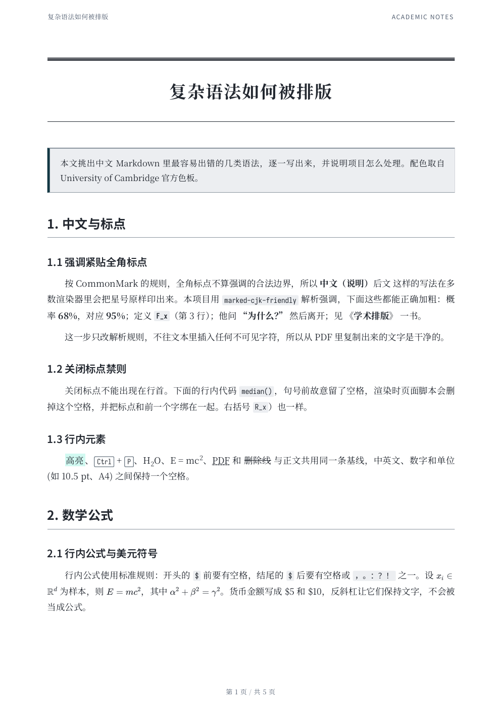
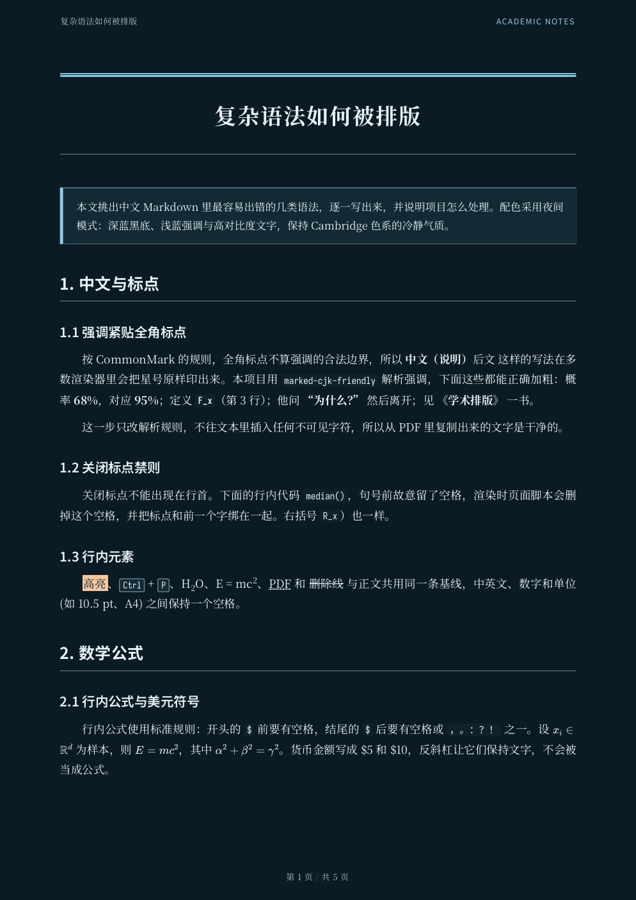
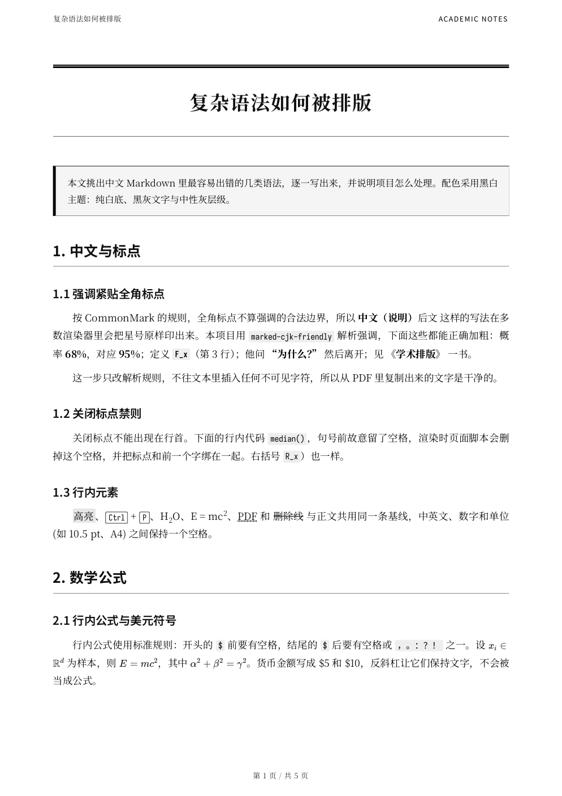

# Academic Markdown CSS

Chinese-first A4 academic PDF themes · light / night / monochrome

[English](README.en.md) · [中文](README.md)

| Light | Night | Monochrome |
|:--:|:--:|:--:|
| [](example.pdf) | [](example-night.pdf) | [](example-mono.pdf) |

[Example Markdown](example.md) · [Light PDF](example.pdf) · [Night PDF](example-night.pdf) · [Monochrome PDF](example-mono.pdf)

> This is a Chinese-first academic typesetting theme and configuration for [md-to-pdf](https://github.com/simonhaenisch/md-to-pdf): CSS, fonts, pagination, running headers, and three palettes. It is not a Markdown editor or a full LaTeX engine.

| Area | What you get |
|---|---|
| Layout | A4, 10.5 pt body text, 1.8 line height, first-line indentation, justified text, three-line tables, automatic compact layout for wide tables, repeated table headers, running headers, page numbers, PDF bookmarks |
| Content | Code highlighting, diff blocks, GitHub alerts, KaTeX, Mermaid, `<details>`, task lists, definition lists |
| Themes | Light / night / monochrome, all checked against WCAG 2.2 AA |
| Output | CID TrueType font embedding, inlined KaTeX fonts, height-based pagination for tall tables and code blocks |

`example.md` is six pages long. Each section picks a kind of syntax that is easy to get wrong (CJK emphasis and punctuation rules, maths, code wrapping, nested structures, tables and wide tables, diagrams, footnotes), shows it, and explains how the project handles it. Pagination and font-embedding regressions are covered by the fixtures under `test/`.

## Quick Start

```bash
npm install
npm run render:all -- path/to/paper.md   # render your own document; the PDF is written next to the Markdown file, replacing a PDF of the same name
npm run build                            # optional: render the example to check that the environment works
```

`npm run build` renders the light version of `example.md` to `example.pdf`, which confirms that the browser and fonts are installed. Night and monochrome examples:

```bash
npm run build:night  # example-night.pdf
npm run build:mono   # example-mono.pdf
```

If rendering fails with `Could not find Chrome`, Puppeteer did not download a browser. Typical causes: `npm install --ignore-scripts`, `PUPPETEER_SKIP_DOWNLOAD` being set, or a proxy or firewall blocking the download. Install it by hand and check:

```bash
npx puppeteer browsers install chrome   # download the Chrome build that matches Puppeteer
npx puppeteer browsers list             # show the installed browsers and their paths
```

Browsers are cached in `~/.cache/puppeteer`; change that with `PUPPETEER_CACHE_DIR`, set a proxy with `HTTPS_PROXY`, or point `PUPPETEER_EXECUTABLE_PATH` at a Chrome you already have. Recent npm versions (opt-in from 11.16, the default in 12) block dependency install scripts, including the one that downloads Puppeteer's browser; this project allows it in the `allowScripts` field of `package.json`. After upgrading Puppeteer, update the version in that entry.

## Rendering Your Own Document

Use `render:all`. The file can live anywhere, and the PDF is written next to the Markdown file by default:

```bash
npm run render:all -- ~/notes/paper.md --theme night --outdir ~/notes/pdf   # a file outside this repo, PDF in another directory
npm run render:all -- docs/ --outdir dist                                    # every *.md in the directory
npm run render:all -- a.md b.md --theme mono                                 # light / night / mono
```

Each file's own directory is its `basedir` by default, so images and other relative assets can sit next to the Markdown file. To reference assets in a parent directory, pass `--basedir` with a common directory that contains every input. KaTeX fonts are inlined, so `basedir` does not affect maths fonts.

`npm run render`, `render:night`, and `render:mono` are the plain `md-to-pdf` commands: they can only write next to the Markdown file, a file outside this project needs `--basedir <the file's directory>`, and they ignore the per-document settings below (the sibling stylesheet and `header_label`).

In a non-interactive WSL/CI shell, load nvm first:

```bash
source "$HOME/.nvm/nvm.sh"
npm run render:all -- path/to/your-file.md
```

### Per-document settings

- **Header title**: the first `h1` by default, truncated with an ellipsis when it is too long. Set `document_title` in the frontmatter for a shorter one.
- **Header label**: the right side of the running header defaults to `ACADEMIC NOTES`. Set `header_label` in the frontmatter to give each document its own; use the `MD_HEADER_LABEL` environment variable to give every document in a batch the same one. Precedence: frontmatter, environment variable, default. An empty string hides the label.
- **Sibling stylesheet**: when `report.css` sits next to `report.md`, `render:all` adds it after the theme's stylesheets, for that document only.

```markdown
---
document_title: Retrieval-Augmented Generation
header_label: Robotics
---
```

```bash
MD_HEADER_LABEL="Course notes" npm run render:all -- notes/    # for documents without header_label
MD_HEADER_LABEL="" npm run render:all -- notes/                # hide the right-hand label
```

Do not use `md-to-pdf`'s own `--stylesheet`, and do not put `stylesheet:` or `css:` in the frontmatter: they replace rather than append, so the base theme (and, for `css`, the inlined KaTeX fonts) is lost.

## Themes

| Theme | Build | Render | Background | Body | Accent / links |
|---|---|---|---|---|---|
| Light / default | `npm run build` | `npm run render` | `#ffffff` | `#232830` | `#133844` |
| Night | `npm run build:night` | `npm run render:night` | `#0b1b23` | `#e8f0f4` | `#8ecae6` |
| Monochrome | `npm run build:mono` | `npm run render:mono` | `#ffffff` | `#111111` | `#000000` |

Night and monochrome only add a colour layer; layout, fonts, and pagination are shared with the light theme.

## Requirements and Fonts

- Node.js >= 22.12
- Noto Serif SC / Noto Sans SC: static TTF, weights 400 / 600 / 700 recommended
- Noto Sans: fallback for Greek letters and superscripts, usually provided by `fonts-noto-core`
- Sarasa Mono SC: code font, TTF

**Use static TTF.** Variable fonts such as `NotoSerifSC[wght].ttf` are still embedded as Type 3 by Chrome/Skia; so are the CFF/OTC fonts from `fonts-noto-cjk`. Type 3 roughly doubles the PDF size and can hurt print preflight and some RIPs.

```bash
css=$(curl -fsSL 'https://fonts.googleapis.com/css2?family=Noto+Serif+SC:wght@400;600;700&family=Noto+Sans+SC:wght@400;600;700')
mkdir -p "$HOME/.local/share/fonts/noto-sc-ttf"
printf '%s\n' "$css" | grep -o 'https://[^)]*\.ttf' | while read -r url; do
  curl -fsSL "$url" -o "$HOME/.local/share/fonts/noto-sc-ttf/$(basename "$url")"
done
fc-cache -f
```

Download the TTF build of Sarasa Mono SC from [Sarasa Gothic Releases](https://github.com/be5invis/Sarasa-Gothic/releases), then install and refresh the cache:

```bash
sudo cp SarasaMonoSC-*.ttf /usr/local/share/fonts/
sudo fc-cache -f
```

Verify the fonts:

```bash
fc-match "Noto Serif SC"
fc-match "Noto Sans SC"
fc-match "Noto Sans"
fc-list | grep -i "Sarasa Mono SC"
```

## Customisation

- `academic-markdown.css`: base layout and light theme; font stacks live in `--font-serif`, `--font-sans`, and `--font-mono`
- `academic-markdown-night.css` / `academic-markdown-mono.css`: night / monochrome colour layers
- `md-to-pdf.config.js`: page margins (`PAGE`), header/footer, Mermaid, pagination threshold
- `md-to-pdf.night.config.js` / `md-to-pdf.mono.config.js`: theme entry points

To restyle a single document, leave the theme files alone and put the rules in its sibling stylesheet (see "Per-document settings" above).

## Tables

### Wide tables

A table with many columns needs no hand-tuned widths; these steps run automatically at render time. `example.md` section 5.2 has a 10-column example, and `test/fixtures/wide-table.md` collects shapes from 4 to 30 columns.

| Step | What happens |
|---|---|
| Smaller type | 7–8 columns use 8.6 pt, 9 or more use 8 pt, and the cells' horizontal padding tightens |
| Short cells never wrap | A column whose widest cell is at most 5 em (about 5 CJK characters or 9 Latin ones) never wraps, so `29.7`, `RAG-T`, and `最先进模型` are not split |
| Medium cells stay on one line if they can | A column whose widest cell is at most 12 em stays on one line while the table has room, and wraps normally when it does not |
| Header words stay whole | Headers wrap only at spaces, hyphens and the like; a CJK word is never split in the middle |
| Whole-table scaling | If the table is still wider than the text block, its type is scaled down proportionally. A table like 30 columns ends up very small and should be split in two |

Body cells can still break anywhere (long addresses and identifiers need that), so columns with long sentences wrap as usual. HTML tables with `colspan` / `rowspan` get no column protection, only the type tiers and whole-table scaling. To right-align a numeric column, write `---:` in the header separator row.

### Column widths

Column widths are allocated automatically. To fix a column, wrap the table in a container with a class name and write the rule against that class in the sibling stylesheet:

```markdown
<div class="results">

| Model | Notes | Value |
|---|---|---|
| … | … | … |

</div>
```

```css
.results th:nth-child(1) { width: 12%; }
.results th:nth-child(2) { width: 70%; }
```

Do not select a table by position (`table:nth-of-type(2)`): adding another table to the document moves the rule onto the wrong one. You can also select by column count; `table:has(thead th:nth-child(8))` matches tables with 8 or more columns. Avoid enabling `table-layout: fixed` globally; it makes every table use equal-width columns.

### Pagination

A table with fewer than 9 rows and no taller than about 40% of the content area stays on one page where possible, together with the sentence that introduces it. Longer tables may span pages: the header repeats, every row stays whole, and a split leaves at least two rows on each side of the break. To decide by hand, wrap the lead-in sentence and the table in a container:

```markdown
<div class="keep-together">

**Table 3:** This table is not split.

| … | … |
|---|---|
| … | … |

</div>
```

`keep-together` keeps the container on one page; `allow-break` lets the tables, code blocks, quotes and so on inside split across pages whatever their height. Leave a blank line before and after the container tags, or the Markdown inside is not parsed.

## Extended Syntax

| Syntax | How to write it | Notes |
|---|---|---|
| Alerts | `> [!NOTE]` | NOTE / TIP / IMPORTANT / WARNING / CAUTION |
| KaTeX | `$...$` / `$$...$$` | Inline and display maths; not full LaTeX. No spaces are required around `$`, and a dollar sign that is not maths must be written `\$` |
| Footnotes | `text[^1]` and `[^1]: note` | References become superscripts and the notes are collected under a "脚注" heading at the end; every reference needs a definition |
| Diff | `diff` code block | `+` / `-` lines are highlighted separately |
| Mermaid | `mermaid` code block | Rendered to SVG inside Chromium |
| Collapsible Q&A | `<details><summary>` | Expanded automatically for printing |

See [example.md](example.md) for complete runnable examples.

### Footnotes

```markdown
Right: knowledge-intensive tasks[^code].

[^code]: The note. Indent further paragraphs of a note by four spaces.

Wrong: knowledge-intensive tasks.<sup>1</sup>
```

- Notes are always printed at the end of the document, not at the foot of the page (Chromium does not support page-foot footnotes). Where the definitions are written does not affect rendering.
- References and definitions must pair up. `render:all` warns before rendering about a reference without a definition, a definition that is never referenced, a duplicated label, and a `<sup>number</sup>` paragraph; warnings do not stop the render.
- `<sup>1</sup>` raises no error and the PDF is still produced, but it is plain text and never reaches the "脚注" section.
- The heading of that section is fixed to "脚注", the footer to "第 N 页 / 共 M 页", and the page language to `zh-CN`. The project targets Chinese documents, so an English document carries these Chinese strings.

Migrating older documents:

| Source | Replace with |
|---|---|
| `<sup>1</sup>` in the text and `<sup>1</sup> note` at the end | `[^1]` and `[^1]: note` |
| Superscript digits pasted from Word or PDF (such as `¹`) | the same, dropping the superscript character |
| Pandoc footnotes `[^1]` | the same syntax, usable as is; Pandoc inline notes `^[note]` become a reference plus a definition |
| Endnotes, numeric citations `[29]` | keep citations like `[29]` as they are; do not turn them into footnotes |

### PDF Metadata

The PDF Title comes from the first `h1`; Chromium does not write Author, Subject, or Keywords. If archiving needs them, set them after rendering with a tool such as `exiftool`.

## Accessibility

- Body-text contrast: light 14.81:1, night 15.23:1, monochrome 18.88:1
- Links keep an underline; alerts have text labels, and diff blocks keep `+` / `-`, so information is not conveyed by colour alone
- Run `npm run check:contrast` to check the key colour pairs of all three themes

## Verification

```bash
npm run verify -- dist/      # check PDFs: Type 3 fonts, literal **, Mermaid/KaTeX render errors, blank pages
npm run build:all            # regenerate the three example PDFs
npm run verify:examples      # check the example PDFs and require embedded KaTeX fonts
npm test                     # all tests: needs Chromium, the fonts, and poppler
npm run test:unit            # tests that need no browser; this is what CI runs
```

`verify` needs poppler (`pdfinfo`, `pdffonts`, `pdftotext`, `pdftoppm`) and exits with 1 when any check fails. A blank page is one with neither text nor any drawing inside the content box; a page holding only a figure is not blank. Add `--allow-asterisks` for documents that show `**` itself, such as ones about Markdown syntax.

`verify` does not check table readability: a PDF with a number split across two lines or a squeezed column still passes. Chromium clips whatever overflows the content box, and clipped text is not in the PDF, so it cannot be found there either. Look at the preview after laying out a wide table; the automatic handling is guarded by `test/fixtures/wide-table.md`.

## Notes

- Mermaid, KaTeX, and Alerts are processed locally; no CDN is required.
- Night is intended for screen reading. Use light or monochrome for paper. Monochrome suits single-colour printing, photocopying, and contexts where colour would distract.
- For table pagination see the "Tables" section above; code blocks, quotes, alerts, details blocks, and figures taller than about 40% of the content area may also span pages.
- Display formulas wider than the content area are scaled down to fit it; long inline code without break points wraps at the page margin.
- When a diagram or formula fails to render the PDF is still written, with "Mermaid 渲染失败" or "KaTeX 渲染失败" printed in its place; `verify` reports those pages.
- Code blocks use `pre-wrap`; Chromium does not apply a hanging indent to soft-wrapped lines, so keep code lines under 100 characters where possible.
- Strong emphasis next to full-width punctuation is parsed by `marked-cjk-friendly`.
- To have an AI write Markdown for these themes, give it [docs/ai-markdown-guide.md](docs/ai-markdown-guide.md) (in Chinese) as the style guide.
- Implementation notes for maintainers: [docs/architecture.md](docs/architecture.md) (Chinese).

## License

MIT License — free to use, modify, and distribute with the copyright notice preserved. See [LICENSE](LICENSE).
