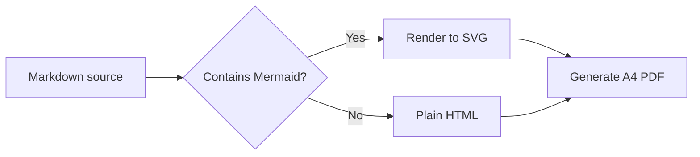

# Academic Markdown CSS

[English](README.en.md) · [中文](README.md)

A Chinese-first, academic-style Markdown stylesheet for producing A4 PDFs with [md-to-pdf](https://github.com/simonhaenisch/md-to-pdf).

Body text and headings use Noto Serif / Sans CJK SC; code uses Sarasa Mono SC. The layout includes first-line indentation, justified text, three-line tables, running headers, page numbers, and PDF bookmarks.

Two themes are included: a light theme and a night theme. They share the same layout and typography and differ only in colour.

Light preview:


Night preview:


[Light example PDF](example.pdf) · [Night example PDF](example-night.pdf) · [Example Markdown](example.md)

## Features

- A4 academic layout: 10.5 pt body text, 1.8 line height, first-line indentation, justified text
- Three-line tables, repeated headers across pages, short tables kept intact
- Automatic document title in the page header and page numbers in the footer
- PDF bookmarks generated from headings
- Code blocks, inline code, block quotes, and figure captions
- Diff blocks with distinct addition and deletion colours
- GitHub-style alerts: `NOTE`, `TIP`, `IMPORTANT`, `WARNING`, `CAUTION`
- KaTeX inline and display maths
- Mermaid flowcharts and sequence diagrams rendered locally in Chromium
- Task lists, definition lists, and collapsible `<details>` Q&A
- `<details>` elements are expanded automatically for printing
- Generic configuration: the first `h1` is used as the document title
- Cambridge light palette and a high-contrast night palette, both checked against WCAG 2.2 AA

## Requirements

- Node.js >= 18
- Noto Serif CJK SC
- Noto Sans CJK SC
- Sarasa Mono SC (code font)
- Mermaid, KaTeX, and other npm dependencies installed by `npm install`

On Debian / Ubuntu, install the Noto fonts with:

```bash
sudo apt install fonts-noto-cjk
```

Download the TTF build of Sarasa Mono SC from [Sarasa Gothic Releases](https://github.com/be5invis/Sarasa-Gothic/releases), install it into the system font directory, and refresh the font cache:

```bash
# Adjust the path to your downloaded files.
sudo cp SarasaMonoSC-*.ttf /usr/local/share/fonts/
sudo fc-cache -f
```

Verify that the fonts are available:

```bash
fc-list | grep -iE "Noto (Serif|Sans) CJK SC|Sarasa Mono SC"
```

## Quick Start

```bash
npm install
npm run build
```

`npm run build` renders the light version of `example.md` to `example.pdf`.

## Rendering Your Own Document

```bash
npm run render -- path/to/your-file.md
```

The PDF is written next to the Markdown file. For the night theme:

```bash
npm run render:night -- path/to/your-file.md
```

You can also call `md-to-pdf` directly:

```bash
md-to-pdf your-file.md --config-file md-to-pdf.config.js
```

If the Markdown file is outside this project, pass an appropriate `--basedir`.

## Extended Syntax

### Alerts

The five GitHub alert types are supported:

```markdown
> [!NOTE]
> This is a note. It can contain **bold text**, `inline code`, and lists.
>
> - First item
> - Second item

> [!WARNING]
> This is a warning.
```

### LaTeX Maths

Inline maths uses `$...$`; display maths uses `$$...$$`. Both are rendered with KaTeX:

```latex
Inline: $E = mc^2$.

$$
\operatorname{softmax}(z_i) =
\frac{\exp(z_i)}{\sum_{j=1}^{n}\exp(z_j)}
$$
```

This is the commonly used KaTeX subset, not a full LaTeX document engine. Packages, chapters, and cross-references are not supported.

### Diff Blocks

Use the `diff` language to colour lines beginning with `+` and `-`:

````markdown
```diff
- Old implementation: fill missing values with column means
+ New implementation: standardize with training-set statistics
+ Keep the original row indices
```
````

### Mermaid Diagrams

Use the `mermaid` language:

````markdown

````

Mermaid is loaded from the local npm package and rendered in Chromium without a CDN. Regular flowcharts and sequence diagrams work out of the box. Split very large diagrams into smaller ones to avoid unreadably small text.

## Title and Running Header

By default, the first `h1` in the document is used as:

- the PDF metadata title
- the left side of the running header

The right side is always `ACADEMIC NOTES`. To override the title, add frontmatter at the top of the Markdown file:

```markdown
---
document_title: My document title
---

# Document heading
```

`document_title` takes precedence over the automatically detected title.

## Themes

Light is the default theme. The night theme uses the same layout and typography:

```bash
npm run build        # Light: example.pdf
npm run build:night  # Night: example-night.pdf
```

The night theme is loaded by `md-to-pdf.night.config.js` as an additional stylesheet layer, so it does not change the light build.

## Customisation

Colours, font sizes, line heights, and page margins are defined in these files:

- `academic-markdown.css`: base layout and light theme
- `academic-markdown-night.css`: night colour overrides
- `md-to-pdf.config.js`: light configuration, A4 margins, header/footer, and Mermaid theme
- `md-to-pdf.night.config.js`: night theme entry point

The light palette is based on the [University of Cambridge Colour Guidelines](https://www.cam.ac.uk/brand-resources/guidelines/colour):

| Use | Value |
|---|---|
| Body text | `#232830` |
| Accent | `#133844` |
| Secondary grey | `#546072` |
| Rules | `#8a949e` |
| Light surface | `#ECEEF1` |
| Code accents | `#911449` / `#13553A` / `#29347A` |

Main night palette colours:

| Use | Value |
|---|---|
| Page background | `#0b1b23` |
| Body text | `#e8f0f4` |
| Secondary text | `#a8c0cc` |
| Accent / links | `#8ecae6` |
| Code background | `#0f222b` |
| Card / quote background | `#132a34` |

## Accessibility

- Light body-text contrast: 14.81:1; night body-text contrast: 15.23:1
- Night link contrast: 9.82:1; links also keep an underline
- Alerts use text labels and a coloured left rule; diff blocks keep `+` / `-` markers, so information is not conveyed by colour alone
- Link underlines, `kbd` borders, and rules meet the 3:1 non-text contrast requirement
- Run `npm run check:contrast` to re-check the key night-theme colour pairs

## Project Structure

```text
.
├── academic-markdown.css        # Base academic layout
├── academic-markdown-night.css  # Night colour layer
├── md-to-pdf.config.js          # Light configuration
├── md-to-pdf.night.config.js    # Night configuration entry point
├── example.md                   # Style showcase
├── example.pdf                  # Light example
├── example-night.pdf            # Night example
├── scripts/
│   ├── build-night.js           # Night example build
│   └── check-contrast.mjs       # WCAG contrast check
├── assets/
│   ├── example-figure.svg       # Light example figure
│   ├── example-figure-night.svg # Night example figure
│   ├── preview.png              # Light preview
│   └── preview-night.png        # Night preview
├── package.json
├── package-lock.json
├── README.md
└── README.en.md
```

## Notes

- Mermaid, KaTeX, and Alerts are processed locally in Chromium or Node.js; Mermaid diagrams are rendered to SVG before being written to the PDF. No CDN is required.
- The night theme is intended for screen reading. Printing it uses a lot of ink; use the light theme for paper copies.
- Short tables stay on one page; long tables may span pages, depending on Chromium's CSS pagination.
- The example document is a style showcase and can be replaced with your own Markdown.
