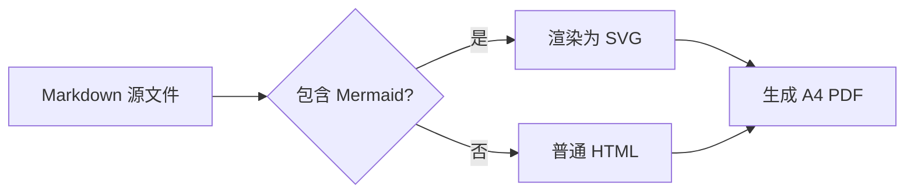

# Academic Markdown CSS

一套中文优先的学术风格 Markdown 样式，配合 [md-to-pdf](https://github.com/simonhaenisch/md-to-pdf) 生成 A4 PDF。

正文与标题使用 Noto Serif / Sans CJK SC，代码使用 Sarasa Mono SC；页面采用首行缩进、两端对齐、三线表、页眉页码和 PDF 书签。

提供浅色与夜间两套主题，版式一致，只切换配色。

浅色预览：


夜间预览：


[浅色示例 PDF](example.pdf) · [夜间示例 PDF](example-night.pdf) · [查看示例 Markdown](example.md)

## 特性

- A4 学术排版：10.5pt 正文、1.8 行距、首行缩进、两端对齐
- 三线表、跨页表头重复、短表不拆页
- 页眉自动显示文档标题，页脚显示页码
- 按标题自动生成 PDF 书签
- 代码块、行内代码、引用块、图片图注
- Diff 代码块：新增行与删除行分别着色
- GitHub 风格 Alerts：`NOTE`、`TIP`、`IMPORTANT`、`WARNING`、`CAUTION`
- KaTeX 行内与行间数学公式
- Mermaid 流程图、时序图等，在 Chromium 内本地渲染
- 任务列表、定义列表、`<details>` 折叠问答
- 自动展开 `<details>`，便于打印
- 通用配置：自动读取每个 Markdown 的第一个 `h1` 作为标题
- Cambridge 浅色 / 夜间两套色板，均满足 WCAG 2.2 AA 对比度要求

## 环境

- Node.js >= 18
- Noto Serif CJK SC
- Noto Sans CJK SC
- Sarasa Mono SC（代码字体）
- Mermaid、KaTeX 等 npm 依赖（`npm install` 会自动安装）

Debian / Ubuntu 可安装 Noto 字体：

```bash
sudo apt install fonts-noto-cjk
```

Sarasa Mono SC 从 [Sarasa Gothic Releases](https://github.com/be5invis/Sarasa-Gothic/releases) 下载 TTF 版本，安装到系统字体目录后刷新字体缓存：

```bash
# 以实际下载路径为准
sudo cp SarasaMonoSC-*.ttf /usr/local/share/fonts/
sudo fc-cache -f
```

可以用下面的命令确认字体：

```bash
fc-list | grep -iE "Noto (Serif|Sans) CJK SC|Sarasa Mono SC"
```

## 快速开始

```bash
npm install
npm run build
```

`npm run build` 会渲染浅色版 `example.md`，生成 `example.pdf`。

## 渲染自己的文档

```bash
npm run render -- path/to/your-file.md
```

输出 PDF 默认生成在 Markdown 文件旁边。夜间模式使用：

```bash
npm run render:night -- path/to/your-file.md
```

也可以直接使用 `md-to-pdf`：

```bash
md-to-pdf your-file.md --config-file md-to-pdf.config.js
```

如果文件不在项目目录内，需要额外指定 `--basedir`。

## 扩展语法

### Alerts 提示块

支持 GitHub 风格的 `NOTE`、`TIP`、`IMPORTANT`、`WARNING`、`CAUTION` 五种提示块：

```markdown
> [!NOTE]
> 这里是说明文字，可以包含 **粗体**、`行内代码` 和列表。
>
> - 第一项
> - 第二项

> [!WARNING]
> 这里是警告文字。
```

### LaTeX 数学

支持行内公式 `$...$` 和行间公式 `$$...$$`，由 KaTeX 渲染：

```latex
行内公式：$E = mc^2$。

$$
\operatorname{softmax}(z_i) =
\frac{\exp(z_i)}{\sum_{j=1}^{n}\exp(z_j)}
$$
```

这是 KaTeX 的常用数学语法子集，不是完整的 LaTeX 文档引擎；不包含宏包、章节和交叉引用等能力。

### Diff 代码块

用 `diff` 标记代码块，`+` 和 `-` 开头的行会自动着色：

````markdown
```diff
- 旧实现：按列均值填充缺失值
+ 新实现：按训练集统计量标准化
+ 同时保留原始索引
```
````

### Mermaid 图表

用 `mermaid` 标记代码块：

````markdown

````

Mermaid 使用本地 npm 包，在 Chromium 内渲染，不请求 CDN。普通流程图、时序图等可以直接使用；过大的图建议拆分为多张，避免缩小后文字过小。

## 标题与页眉

默认取文档的第一个 `h1` 作为：

- PDF 元数据标题
- 页眉左侧文字

页眉右侧固定为 `ACADEMIC NOTES`。如果某个文档需要单独指定标题，可以在 Markdown 开头写 frontmatter：

```markdown
---
document_title: 我的文档标题
---

# 正文标题
```

frontmatter 中的 `document_title` 会覆盖自动提取的标题。

## 主题

浅色是默认主题；夜间模式使用同一套版式和字体：

```bash
npm run build        # 浅色：example.pdf
npm run build:night  # 夜间：example-night.pdf
```

夜间模式通过 `md-to-pdf.night.config.js` 加载覆盖层，不影响浅色构建。

## 自定义

颜色、字号、行距和页边距集中在这些文件：

- `academic-markdown.css`：基础版式与浅色主题
- `academic-markdown-night.css`：夜间配色覆盖层
- `md-to-pdf.config.js`：浅色主题配置、A4 页边距、页眉页脚、Mermaid 主题
- `md-to-pdf.night.config.js`：夜间主题配置入口

浅色主题来自 [University of Cambridge Colour Guidelines](https://www.cam.ac.uk/brand-resources/guidelines/colour)：

| 用途 | 色值 |
|---|---|
| 正文 | `#232830` |
| 强调色 | `#133844` |
| 辅助灰 | `#546072` |
| 分隔线 | `#8a949e` |
| 浅色底 | `#ECEEF1` |
| 代码辅助色 | `#911449` / `#13553A` / `#29347A` |

夜间主题主要色值：

| 用途 | 色值 |
|---|---|
| 页面底色 | `#0b1b23` |
| 正文 | `#e8f0f4` |
| 次要文字 | `#a8c0cc` |
| 强调 / 链接 | `#8ecae6` |
| 代码底色 | `#0f222b` |
| 卡片 / 引用底色 | `#132a34` |

## 可访问性

- 浅色正文对比度 14.81:1，夜间正文对比度 15.23:1
- 夜间链接对比度 9.82:1，并保留下划线
- Alerts 使用类型标题和左侧色条，Diff 保留 `+` / `-` 符号，不只依赖颜色
- 链接下划线、`kbd` 边框和分隔线等关键非文本元素均至少 3:1
- 运行 `npm run check:contrast` 复查夜间主题的关键色对

## 项目结构

```text
.
├── academic-markdown.css       # 学术排版基础样式
├── academic-markdown-night.css # 夜间配色覆盖层
├── md-to-pdf.config.js         # 浅色配置
├── md-to-pdf.night.config.js   # 夜间配置入口
├── example.md                  # 样式示例
├── example.pdf                 # 浅色示例
├── example-night.pdf           # 夜间示例
├── scripts/
│   ├── build-night.js          # 夜间示例构建
│   └── check-contrast.mjs      # WCAG 对比度检查
├── assets/
│   ├── example-figure.svg      # 浅色示例图
│   ├── example-figure-night.svg # 夜间示例图
│   ├── preview.png             # 浅色预览
│   └── preview-night.png       # 夜间预览
├── package.json
├── package-lock.json
└── README.md
```

## 说明

- Mermaid、KaTeX 和 Alerts 都在本地 Chromium 或 Node.js 中处理，不依赖 CDN；Mermaid 图会先渲染成 SVG 再写入 PDF。
- 夜间模式适合屏幕阅读；打印时会消耗较多墨水，纸质版建议使用浅色主题。
- 短表保持整表不拆页、长表允许跨页，依赖 Chromium 的 CSS 分页能力。
- 示例文档仅用于展示样式，可直接替换为自己的 Markdown。
