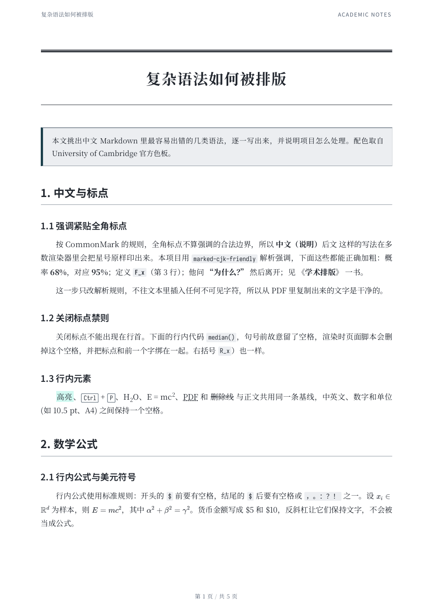
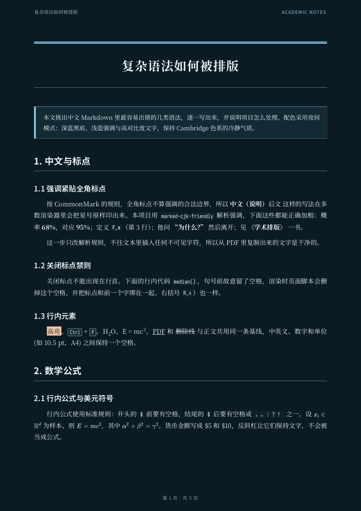
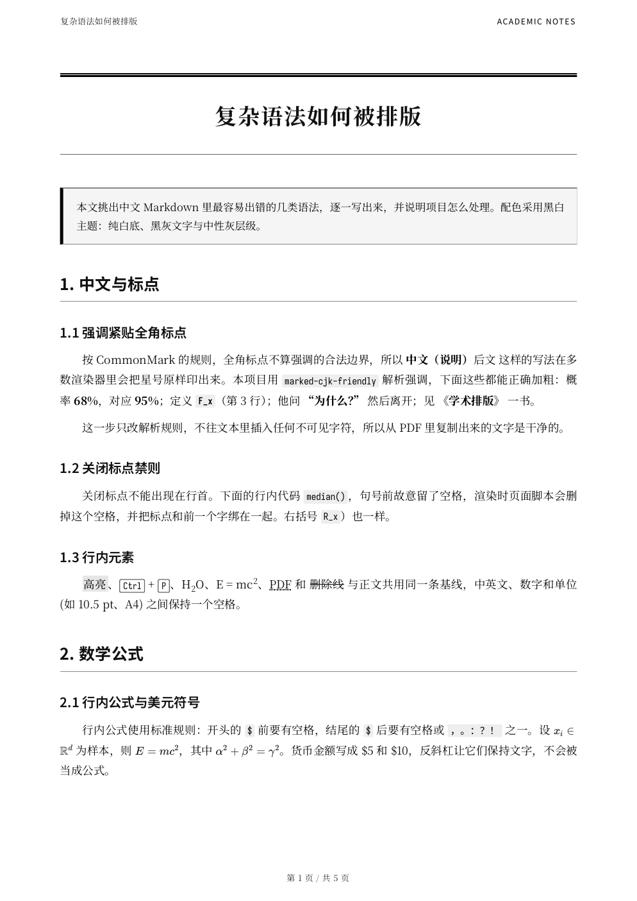

# Academic Markdown CSS

中文优先的 A4 学术 PDF 主题 · 浅色 / 夜间 / 黑白

[中文](README.md) · [English](README.en.md)

| 浅色 | 夜间 | 黑白 |
|:--:|:--:|:--:|
| [](example.pdf) | [](example-night.pdf) | [](example-mono.pdf) |

[示例 Markdown](example.md) · [浅色 PDF](example.pdf) · [夜间 PDF](example-night.pdf) · [黑白 PDF](example-mono.pdf)

> 本项目是 [md-to-pdf](https://github.com/simonhaenisch/md-to-pdf) 的中文学术排版主题与配置：CSS、字体、分页、页眉页脚和三套配色。它不是 Markdown 编辑器，也不是完整的 LaTeX 文档引擎。

| 能力 | 内容 |
|---|---|
| 排版 | A4、10.5pt 正文、1.8 行距、首行缩进、两端对齐、三线表、宽表自动紧凑、跨页表头、页眉页码、PDF 书签 |
| 内容 | 代码高亮、Diff、GitHub Alerts、KaTeX、Mermaid、`<details>`、任务列表、定义列表 |
| 主题 | 浅色 / 夜间 / 黑白，三套色板均通过 WCAG 2.2 AA 对比度检查 |
| 输出 | CID TrueType 字体嵌入、KaTeX 字体内联、长表/长代码块按高度分页 |

`example.md` 有 6 页，每一节挑一类容易出错的语法（中文强调与标点禁则、公式、代码折行、嵌套结构、表格与宽表、图表、脚注），写出来并说明项目怎么处理；分页、字体嵌入等回归检查由 `test/` 下的夹具负责。

## 快速开始

```bash
npm install
npm run build
```

`npm run build` 渲染浅色版 `example.md`，生成 `example.pdf`。夜间和黑白示例：

```bash
npm run build:night  # example-night.pdf
npm run build:mono   # example-mono.pdf
```

如果渲染时报 `Could not find Chrome`，说明 Puppeteer 没有下载到浏览器。常见原因：`npm install` 带了 `--ignore-scripts`，设置了 `PUPPETEER_SKIP_DOWNLOAD`，或者下载被代理、防火墙拦住。手动补装并确认：

```bash
npx puppeteer browsers install chrome   # 下载 Puppeteer 对应版本的 Chrome
npx puppeteer browsers list             # 查看已安装的浏览器及路径
```

浏览器默认缓存在 `~/.cache/puppeteer`，可用 `PUPPETEER_CACHE_DIR` 改位置，`HTTPS_PROXY` 配代理；想直接用本机已有的 Chrome，设置 `PUPPETEER_EXECUTABLE_PATH`。新版 npm（11.16 起可选，12 起默认）会拦截依赖的安装脚本，Puppeteer 下载浏览器的脚本也在其中；本项目已在 `package.json` 的 `allowScripts` 里放行它。升级 Puppeteer 后，要同步改这一项里的版本号。

## 渲染自己的文档

推荐用 `render:all`。文件放在哪里都可以，PDF 默认写在 Markdown 旁边：

```bash
npm run render:all -- ~/notes/paper.md --theme night --outdir ~/notes/pdf   # 仓库外的文件，输出到另一个目录
npm run render:all -- docs/ --outdir dist                                    # 目录下所有 *.md
npm run render:all -- a.md b.md --theme mono                                 # light / night / mono
```

每个文件默认以自己所在目录作为 `basedir`，图片等相对资源放在 Markdown 旁边即可；要引用上级目录的资源时，用 `--basedir` 指向包含所有输入文件的共同目录。KaTeX 字体已经内联，不受 `basedir` 影响。

`npm run render` / `render:night` / `render:mono` 是 `md-to-pdf` 的原生命令：只能写在 Markdown 旁边，文件不在项目目录内时要自己加 `--basedir <文件所在目录>`，也不支持下面“每篇文档的设置”里的同名样式表和 `header_label`。

WSL/CI 的非登录 shell 里先加载 nvm：

```bash
source "$HOME/.nvm/nvm.sh"
npm run render:all -- path/to/your-file.md
```

### 每篇文档的设置

- **页眉标题**：默认取第一个 `h1`，过长时以省略号截断。想用短标题，在 frontmatter 里写 `document_title`。
- **页眉标签**：页眉右侧默认是 `ACADEMIC NOTES`。在 frontmatter 里写 `header_label`，每篇文档各用各的；批量渲染时用环境变量 `MD_HEADER_LABEL` 给所有文档设同一个。优先级是 frontmatter、环境变量、默认值；设成空字符串则不显示。
- **同名样式表**：`report.md` 旁边有 `report.css` 时，`render:all` 会把它加在主题样式表之后，只影响这一篇。

```markdown
---
document_title: 检索增强生成
header_label: 机器人学导论
---
```

```bash
MD_HEADER_LABEL="课程笔记" npm run render:all -- notes/    # frontmatter 里没写 header_label 的文档
MD_HEADER_LABEL="" npm run render:all -- notes/            # 不显示右侧标签
```

不要用 `md-to-pdf` 自带的 `--stylesheet`，也不要在 frontmatter 里写 `stylesheet:` 或 `css:`：它们是替换而不是追加，会把基础主题（`css` 则是内联的 KaTeX 字体）一起换掉。

## 主题

| 主题 | 构建 | 渲染 | 背景 | 正文 | 强调 / 链接 |
|---|---|---|---|---|---|
| 浅色 / 默认 | `npm run build` | `npm run render` | `#ffffff` | `#232830` | `#133844` |
| 夜间 | `npm run build:night` | `npm run render:night` | `#0b1b23` | `#e8f0f4` | `#8ecae6` |
| 黑白 | `npm run build:mono` | `npm run render:mono` | `#ffffff` | `#111111` | `#000000` |

夜间和黑白主题只叠加颜色，版式、字体和分页与浅色主题共用。

## 环境与字体

- Node.js >= 22.12
- Noto Serif SC / Noto Sans SC：静态 TTF，建议 400 / 600 / 700
- Noto Sans：希腊字母、上下标等符号回退，通常随 `fonts-noto-core` 安装
- Sarasa Mono SC：代码字体，TTF

**必须使用静态 TTF。** `NotoSerifSC[wght].ttf` 这类可变字体在 Chrome/Skia 导出时仍会退化为 Type 3；`fonts-noto-cjk` 的 CFF/OTC 也会。Type 3 会让体积约大一倍，并影响印刷预检和部分 RIP。

```bash
css=$(curl -fsSL 'https://fonts.googleapis.com/css2?family=Noto+Serif+SC:wght@400;600;700&family=Noto+Sans+SC:wght@400;600;700')
mkdir -p "$HOME/.local/share/fonts/noto-sc-ttf"
printf '%s\n' "$css" | grep -o 'https://[^)]*\.ttf' | while read -r url; do
  curl -fsSL "$url" -o "$HOME/.local/share/fonts/noto-sc-ttf/$(basename "$url")"
done
fc-cache -f
```

Sarasa Mono SC 从 [Sarasa Gothic Releases](https://github.com/be5invis/Sarasa-Gothic/releases) 下载 TTF，安装后刷新缓存：

```bash
sudo cp SarasaMonoSC-*.ttf /usr/local/share/fonts/
sudo fc-cache -f
```

确认字体：

```bash
fc-match "Noto Serif SC"
fc-match "Noto Sans SC"
fc-match "Noto Sans"
fc-list | grep -i "Sarasa Mono SC"
```

## 自定义

- `academic-markdown.css`：基础版式与浅色主题；字体栈在 `--font-serif`、`--font-sans`、`--font-mono`
- `academic-markdown-night.css` / `academic-markdown-mono.css`：夜间 / 黑白配色覆盖层
- `md-to-pdf.config.js`：页边距（`PAGE`）、页眉页脚、Mermaid、分页阈值
- `md-to-pdf.night.config.js` / `md-to-pdf.mono.config.js`：主题入口

只想改某一篇文档的样式时，不要改主题文件，把规则写进它的同名样式表（见上文“每篇文档的设置”）。

## 表格

### 宽表

列数多的表不用手调列宽，渲染时按下面几步自动处理。`example.md` 第 5.2 节有一张 10 列的示例，`test/fixtures/wide-table.md` 收集了 4 到 30 列的各种形态。

| 步骤 | 做法 |
|---|---|
| 缩小字号 | 7–8 列用 8.6 pt，9 列起用 8 pt，同时收紧单元格的左右内边距 |
| 短单元格不换行 | 一列里最宽的单元格不超过 5 em（约 5 个汉字或 9 个西文字符），这一列从不换行，所以 `29.7`、`RAG-T`、`最先进模型` 不会被拆开 |
| 中等单元格尽量单行 | 最宽的单元格不超过 12 em 的列，放得下时保持单行；放不下就恢复正常换行 |
| 表头断词 | 表头只在空格、连字符等位置换行，汉字词不会从中间拆开 |
| 整表缩放 | 以上都做了仍然超出版心，整张表按比例缩小字号。30 列这样的表会缩得很小，应当拆成两张 |

正文单元格仍然允许在任意位置折行（长网址和标识符需要），所以包含长句的列照常换行。含 `colspan` / `rowspan` 的 HTML 表不做列保护，只有字号档位和整表缩放。数字列想右对齐，在表头分隔行写 `---:`。

### 列宽

列宽默认自动分配。要固定某一列时，把表包进一个带类名的容器，再在同名样式表里按类名写规则：

```markdown
<div class="results">

| 模型 | 说明 | 数值 |
|---|---|---|
| … | … | … |

</div>
```

```css
.results th:nth-child(1) { width: 12%; }
.results th:nth-child(2) { width: 70%; }
```

不要按位置选表（`table:nth-of-type(2)`）：文档里多加一张表，规则就会落到别的表上。也可以按列数选表，`table:has(thead th:nth-child(8))` 匹配 8 列及以上的表。不建议全局打开 `table-layout: fixed`，那会让所有表格变成等宽列。

### 分页

不足 9 行且不高于约 40% 版心的表尽量整表放在一页，并和它前面的说明句在一起；更长的表允许跨页，续页重复表头，每一行保持完整，拆开时断点两侧各至少留两行。要手动指定，把说明句和表一起包进容器：

```markdown
<div class="keep-together">

**表 3：** 这张表不会被拆开。

| … | … |
|---|---|
| … | … |

</div>
```

`keep-together` 让容器整体不拆页，`allow-break` 让容器里的表、代码块、引用块等无论高矮都可以跨页。容器标签前后各空一行，里面的 Markdown 才会被解析。

## 扩展语法

| 语法 | 写法 | 说明 |
|---|---|---|
| Alerts | `> [!NOTE]` | 支持 NOTE / TIP / IMPORTANT / WARNING / CAUTION |
| KaTeX | `$...$` / `$$...$$` | 行内与行间公式；不是完整 LaTeX。`$` 前后不要求空格，非公式的美元符必须写 `\$` |
| 脚注 | `正文[^1]` 与 `[^1]: 说明` | 引用显示为上标，说明集中印在文末的“脚注”区；引用必须有对应的定义 |
| Diff | `diff` 代码块 | `+` / `-` 行分别着色 |
| Mermaid | `mermaid` 代码块 | Chromium 内渲染为 SVG |
| 折叠问答 | `<details><summary>` | 打印时自动展开 |

完整可运行示例见 [example.md](example.md)。

## 可访问性

- 正文对比度：浅色 14.81:1，夜间 15.23:1，黑白 18.88:1
- 链接保持下划线；Alerts 有类型标题，Diff 保留 `+` / `-`，不只看颜色
- 运行 `npm run check:contrast` 检查三套主题的关键色对

## 验证

```bash
npm run verify -- dist/      # 检查 PDF：Type 3 字体、裸 **、Mermaid/KaTeX 渲染错误、空白页
npm run build:all            # 重新生成三份示例 PDF
npm run verify:examples      # 检查三份示例 PDF，并要求嵌入 KaTeX 字体
npm test                     # 全部测试：需要 Chromium、字体和 poppler
npm run test:unit            # 不需要浏览器的测试，CI 运行这一组
```

`verify` 依赖 poppler（`pdfinfo`、`pdffonts`、`pdftotext`、`pdftoppm`）；任一项不通过时退出码为 1。空白页指版心内既没有文字、也没有任何图形的页，只放一张插图的页不算空白。文档需要展示 `**` 本身（例如讲 Markdown 语法）时加 `--allow-asterisks`。

`verify` 不检查表格可读性：数字被拆行、列被压扁的 PDF 照样 PASS。Chromium 会把超出版心的内容直接裁掉，被裁掉的文字不在 PDF 里，也查不出来。宽表排好之后请对着预览看一眼；表格的自动处理由 `test/fixtures/wide-table.md` 守住。

## 说明

- Mermaid、KaTeX、Alerts 全部本地处理，不依赖 CDN。
- 夜间适合屏幕；打印建议浅色或黑白。黑白适合单色打印、影印和弱化色彩干扰。
- 表格的分页见上文“表格”一节；代码块、引用块、提示块、折叠块和图高于约 40% 版心时也允许跨页。
- 超出版心宽度的行间公式会等比缩小到版心内；没有断点的长行内代码在页边距处折行。
- 图或公式渲染失败时 PDF 仍会生成，出错位置印有“Mermaid 渲染失败”或“KaTeX 渲染失败”；`verify` 会报告这些页。
- 代码块使用 `pre-wrap`；Chromium 对软折行不悬挂缩进，建议单行不超过 100 字符。
- 中文全角标点紧贴 `**` 的强调由 `marked-cjk-friendly` 解析。
- 让 AI 生成 Markdown 时，可把 [docs/ai-markdown-guide.md](docs/ai-markdown-guide.md) 作为写作规范交给它。
- 维护与实现说明见 [docs/architecture.md](docs/architecture.md)。

## License

MIT License — 可自由使用、修改、分发，保留版权声明。详见 [LICENSE](LICENSE)。
