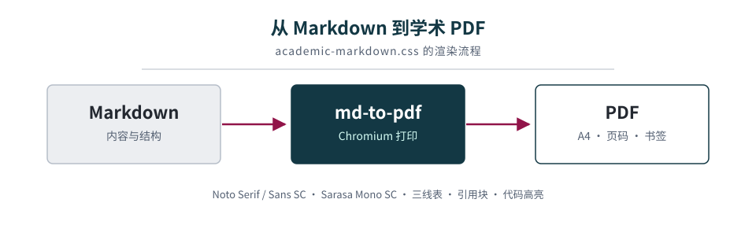
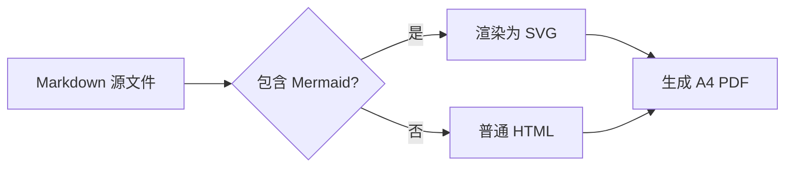

# Academic Markdown 排版示例

> 这是一份用于检查 `academic-markdown.css` 的样式测试文档。它覆盖标题层级、正文强调、列表、引用、表格、代码、Diff、图片、Alerts 提示块、LaTeX 数学、Mermaid 图表、折叠问答和强制分页等常见 Markdown 元素。
>
> 文档的正文和标题使用 Noto Serif / Sans CJK SC，代码使用 Sarasa Mono SC；配色取自 University of Cambridge 官方色板。

**关键词**：Markdown · 学术排版 · md-to-pdf · Noto CJK · Sarasa Mono · Mermaid · KaTeX

<small>文档版本：2026-10 · 仅用于样式展示</small>

## 1. 标题与正文

### 1.1 标题层级

正文段落默认首行缩进两字、两端对齐，行距为 1.8。English text shares the same Noto Serif CJK SC family, so Latin and CJK keep a consistent baseline. 数字与单位如 10.5 pt、A4、2026 年也能保持稳定。

第二段测试 **粗体**、*斜体*、~~删除线~~、`inline code`、[外部链接](https://www.cam.ac.uk/)、<mark>高亮标记</mark>、<kbd>Ctrl</kbd> + <kbd>P</kbd>、H<sub>2</sub>O、E = mc<sup>2</sup> 和 <abbr title="Portable Document Format">PDF</abbr>。

#### 1.1.1 四级标题

四级标题使用左侧短竖线标记，适合图题、代码文件名等次级结构。

##### 1.1.1.1 五级标题

五级标题用于更细的层级。

###### 1.1.1.1.1 六级标题

六级标题保持同样的字体层级，但不再增加额外装饰。

### 1.2 引用块

> 学术写作中的引用块适合放定义、提醒或需要强调的短段落。本样式使用浅灰底和深蓝左边线。
>
> 第二段引用用来检查段落间距，`inline code` 在引用块中也应保持可读。
>
> > 这是嵌套引用，用来检查多层引用时的缩进与边界。

## 2. 列表

- 第一层无序列表
  - 第二层嵌套项
  - 含 `inline code` 的嵌套项
- 另一个第一层项目

1. 有序列表第一项
2. 第二项
   1. 嵌套有序项
   2. 另一个嵌套项
3. 第三项

- [x] 已完成：样式表
- [ ] 待办：补充更多示例
- [ ] 待办：检查打印分页

## 3. 表格

| 对齐方式 | 示例 | 说明 |
|:---|:---:|---:|
| 左对齐 | `text` | 默认列 |
| 居中 | **bold** | 居中列 |
| 右对齐 | 12.34 | 数值列 |
| 代码 | `median()` | 行内代码 |
| 链接 | [Cambridge][cam] | 外部链接 |

## 4. 代码

行内代码如 `标准化(数值列表)` 使用等宽字体和浅灰底。下面分别测试 Python、Bash、JSON 和纯文本代码块。

```python
def standardize(数值列表):
    """按训练集统计量做标准化。"""
    均值 = sum(数值列表) / len(数值列表)
    方差 = sum((x - 均值) ** 2 for x in 数值列表) / len(数值列表)
    return [(x - 均值) / 方差 ** 0.5 for x in 数值列表]
```

```bash
# 安装依赖
npm install

# 渲染示例文档
md-to-pdf example.md --config-file md-to-pdf.config.js
```

```json
{
  "标题": "学术 Markdown 示例",
  "配色": "Cambridge Slate",
  "字体": ["Noto Serif CJK SC", "Sarasa Mono SC"]
}
```

```text
Markdown（中文）→ HTML → PDF
       └─ 学术排版样式
```

Diff 代码块用 `diff` 语言标记，新增行和删除行会分别着色：

```diff
- 旧实现：按列均值填充缺失值
+ 新实现：按训练集统计量标准化
+ 同时保留原始索引
```

## 5. 图片与图注

<figure>
  
  <figcaption>图 1. 从 Markdown 到 A4 PDF 的渲染流程。示意图使用 Cambridge 色板。</figcaption>
</figure>

## 6. Alerts 提示块

GitHub 风格 Alerts 使用 `> [!TYPE]` 语法，支持段落、列表和行内代码。

> [!NOTE]
> 说明块用于补充背景信息，不打断正文的论证节奏。
>
> 它也可以包含列表：
>
> - 第一项
> - 第二项

> [!TIP]
> 小技巧：用 `npm run render -- file.md` 渲染其他文档。

> [!IMPORTANT]
> 重要信息应当简短，避免整段都使用强调色。

> [!WARNING]
> 警告块适合提示可能导致数据错误或构建失败的操作。

> [!CAUTION]
> 小心块用于高风险操作；本示例只展示样式。

## 7. LaTeX 数学

行内公式如 $E = mc^2$、$x_i \in \mathbb{R}^d$，以及 $\alpha^2 + \beta^2 = \gamma^2$。

行间公式使用 `$$`：

$$
\begin{aligned}
\operatorname{softmax}(z_i) &= \frac{\exp(z_i)}{\sum_{j=1}^{n}\exp(z_j)}, \\
\mathbf{X} &\in \mathbb{R}^{n \times d}.
\end{aligned}
$$

矩阵与集合也可以直接排版：

$$
\mathbf{y} \in \{0,1\}^n, \qquad
\hat{\mathbf{y}} = \operatorname{argmax}(\mathbf{X}\mathbf{w} + b).
$$

## 8. Mermaid 图表

Mermaid 流程图在 Chromium 内渲染为 SVG，再写入 PDF；图中可以混排中文和 English。



## 9. 折叠问答

<details>
<summary>为什么正文使用衬线字体？</summary>

衬线字体在长文中提供更稳定的阅读节奏；标题使用无衬线字体，形成清晰层级。

</details>

<details>
<summary>如何修改强调色 `--accent`？</summary>

在 `academic-markdown.css` 顶部的 `:root` 中修改自定义属性即可。

</details>

## 10. 定义列表

<dl>
  <dt>三线表</dt>
  <dd>只有顶线、表头线和底线的表格，常见于学术出版。</dd>
  <dt>留白</dt>
  <dd>页面中未被文字或图形占用的空间，用来建立呼吸感和层级。</dd>
</dl>

> 好的学术排版不喧宾夺主：它让读者把注意力放在论证、数据和文字本身。

---

*示例文档结束。*

[cam]: https://www.cam.ac.uk/brand-resources/guidelines/colour
