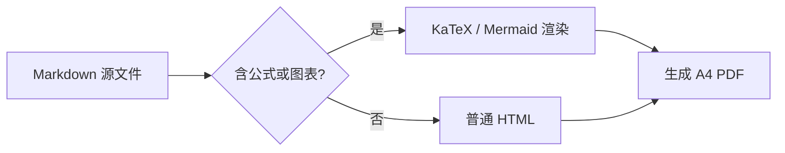
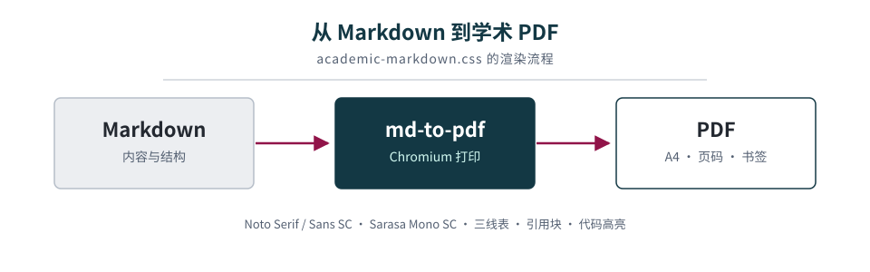

# 复杂语法如何被排版

> 本文挑出中文 Markdown 里最容易出错的几类语法，逐一写出来，并说明项目怎么处理。配色取自 University of Cambridge 官方色板。

## 1. 中文与标点

### 1.1 强调紧贴全角标点

按 CommonMark 的规则，全角标点不算强调的合法边界，所以 **中文（说明）**后文 这样的写法在多数渲染器里会把星号原样印出来。本项目用 `marked-cjk-friendly` 解析强调，下面这些都能正确加粗：概率 **68%**，对应 **95%**；定义 **`F_x`**（第 3 行）；他问 **“为什么？”** 然后离开；见 **《学术排版》** 一书。

这一步只改解析规则，不往文本里插入任何不可见字符，所以从 PDF 里复制出来的文字是干净的。

### 1.2 关闭标点禁则

关闭标点不能出现在行首。下面的行内代码 `median()` ，句号前故意留了空格，渲染时页面脚本会删掉这个空格，并把标点和前一个字绑在一起。右括号 `R_x` ）也一样。

### 1.3 行内元素

<mark>高亮</mark>、<kbd>Ctrl</kbd> + <kbd>P</kbd>、H<sub>2</sub>O、E = mc<sup>2</sup>、<abbr title="Portable Document Format">PDF</abbr> 和 ~~删除线~~ 与正文共用同一条基线，中英文、数字和单位 (如 10.5 pt、A4) 之间保持一个空格。

## 2. 数学公式

### 2.1 行内公式与美元符号

行内公式的 `$` 前后不要求空格，设$x_i \in \mathbb{R}^d$为样本，则$E = mc^2$；也可以写成 $\alpha^2 + \beta^2 = \gamma^2$ 这样带空格的形式。代价是同一行里成对的 `$` 都会被当成公式，所以非公式的美元符要转义：货币金额写成 \$5 和 \$10，反斜杠让它们保持文字。

### 2.2 多行公式与超宽公式

`aligned` 和 `cases` 环境都能用：

$$
\begin{aligned}
\operatorname{softmax}(z_i) &= \frac{\exp(z_i)}{\sum_{j=1}^{n}\exp(z_j)}, \\
\operatorname{ReLU}(x) &= \begin{cases} x, & x > 0, \\ 0, & \text{其他情况。} \end{cases}
\end{aligned}
$$

下面这一条比版心还宽。屏幕上它可以滚动，打印时多出的部分会被裁掉，所以页面脚本在打印宽度下量过之后，把它等比缩小到刚好放下：

$$
x_{1}^2 + x_{2}^2 + x_{3}^2 + x_{4}^2 + x_{5}^2 + x_{6}^2 + x_{7}^2 + x_{8}^2 + x_{9}^2 + x_{10}^2 + x_{11}^2 + x_{12}^2 + x_{13}^2 + x_{14}^2 + x_{15}^2 + x_{16}^2 + x_{17}^2 + x_{18}^2 + x_{19}^2 + x_{20}^2 + x_{21}^2 + x_{22}^2 + x_{23}^2 + x_{24}^2 = r^2
$$

写错的公式不会让转换失败，PDF 里会在原位印出红色的源码和错误提示，由 `npm run verify` 检出。

## 3. 代码

### 3.1 高亮与中文标识符

```python
def standardize(数值列表):
    """按训练集统计量做标准化。"""
    均值 = sum(数值列表) / len(数值列表)
    return [x - 均值 for x in 数值列表]
```

### 3.2 Diff

`diff` 代码块按符号给新增行和删除行着色，符号本身保留，黑白打印时也能分辨：

```diff
  def standardize(数值列表):
-     旧实现：按列均值填充缺失值
+     新实现：按训练集统计量标准化
      return 数值列表
```

### 3.3 超长的行

代码块使用 `pre-wrap`，超过版心的行在页边距处折行，不会伸到页外，折行处的空格也不会被两端对齐拉开：

```bash
curl --silent --show-error --location --retry 3 --output report.pdf "https://example.com/reports/2026/10/academic-markdown-sample-report.pdf"
```

## 4. 嵌套结构

### 4.1 列表、任务和引用

1. 有序列表第一项
2. 第二项
   - 嵌套的无序项，含 `inline code`
   - 再嵌一层
     1. 第三层有序项
3. 第三项

- [x] 已完成：基础样式
- [ ] 待办：补充更多示例

> 引用块可以包含多个段落。
>
> > 嵌套的引用保持缩进，背景不会溢出边框。

### 4.2 提示块里的嵌套内容

提示块用 `> [!TYPE]` 声明，类型共有 NOTE、TIP、IMPORTANT、WARNING、CAUTION 五种。块里可以放列表、代码和公式：

> [!NOTE]
> 说明块适合补充背景，它里面可以继续写：
>
> - 带 `inline code` 的列表项
> - 带公式的列表项，如 $\bar{x} = \frac{1}{n}\sum_i x_i$。
>
> ```python
> print("提示块里的代码块同样高亮")
> ```

> [!WARNING]
> 警告块配有独立的色条和标题，颜色之外还有文字标签，黑白打印时同样能分辨。

## 5. 表格

### 5.1 对齐与行内内容

三线表按表头声明的方向对齐，单元格里可以放行内代码、公式、链接和脚注引用[^table]：

| 方法 | 复杂度 | 说明 |
|:---|:---:|---:|
| 快速排序 | $O(n \log n)$ | 平均情况 |
| 冒泡排序 | $O(n^2)$ | 仅用于教学 |
| `sorted()` | $O(n \log n)$ | 见 [Python 文档](https://docs.python.org/3/howto/sorting.html) |

### 5.2 宽表与短标签

列数一多，表格容易被压得变形：数字在小数点处断开，`RAG-T` 这样的短标签折成两行，表头在词中间换行。项目按下面四条处理：

1. 7 列起自动改用小字号（7–8 列 8.6 pt，9 列以上 8 pt），并收紧单元格内边距；
2. 一列里最宽的单元格不超过 5 个字，这一列从不换行；不超过 12 个字，放得下时保持单行，放不下才换行；
3. 表头只在词与词之间换行；
4. 做完这些仍然超出版心的表，整张按比例缩小，不会被页边裁掉。

下表有 10 列，数字、`Dense-Frozen` 这样的标签和长表头都保持完整（数据为示例）：

| 检索器 | NQ | TQA | WQ | CT | QGen B-1 | QGen QB-1 | MARCO R-L | FEVER-3 标签准确率 | FEVER-2 标签准确率 |
|---|---|---|---|---|---|---|---|---|---|
| BM25 | 28.4 | 40.2 | 31.5 | 32.6 | 16.9 | 21.8 | 54.7 | 74.3 | 90.9 |
| Dense-Frozen | 37.1 | 49.6 | 36.8 | 50.4 | 16.2 | 21.1 | 55.3 | 72.4 | 88.9 |
| Dense-Tuned | 42.8 | 54.1 | 45.7 | 51.3 | 17.4 | 22.0 | 55.8 | 74.0 | 90.2 |

标签和长句混排的表也一样：只有标签这一列不换行，长句列吸收剩下的宽度。

| 任务 | 输入 | 模型 | 输出 |
|---|---|---|---|
| 问答 | define middle ear | BART | 中耳是位于鼓膜内侧的耳部。 |
| | | RAG-T | 中耳包括鼓室和三块听小骨。 |
| 问题生成 | The Divine Comedy | RAG-S | 这部 14 世纪的作品分为三个部分：《地狱篇》、《炼狱篇》和《天堂篇》。 |

### 5.3 分页

不足 9 行且不高于约 40% 版心的表尽量整表放在一页，和它前面的说明句在一起；更长的表允许跨页，续页会重复表头，每一行始终保持完整，拆开时断点两侧各至少留两行。想让某张表一定不拆开，或者让短表也能拆开，把说明句和表一起放进 `<div class="keep-together">` 或 `<div class="allow-break">`。

## 6. 图

### 6.1 Mermaid

Mermaid 在 Chromium 里渲染成矢量图再写入 PDF，节点里可以混排中文和 English；某一张图出错时，只有它自己会被替换成错误提示：



### 6.2 带图注的插图

<figure>
  
  <figcaption>图 1. 从 Markdown 到 A4 PDF 的渲染流程。示意图使用 Cambridge 色板。</figcaption>
</figure>

## 7. 脚注与折叠块

脚注由 `[^标签]` 引用，说明写在别处，统一印在文末[^end]。

<details>
<summary>折叠块在打印时为什么自动展开？</summary>

纸面上没有点击操作，折叠的内容会丢失，所以 `<details>` 在渲染前一律展开。

</details>

[^table]: 脚注引用也可以出现在表格、提示块和列表里。
[^end]: Chromium 不支持把脚注排到每页底部，所以全部集中在文档末尾。
