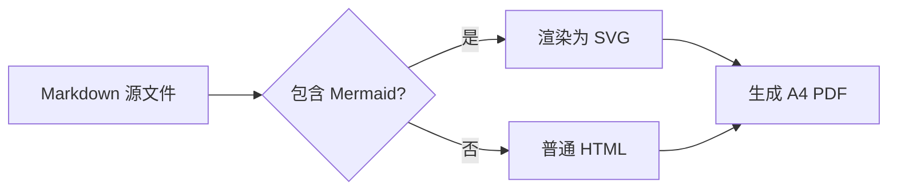

# Academic Markdown 排版示例

> 这是一份用于检查 `academic-markdown.css` 的样式测试文档。它覆盖标题层级、正文强调、列表、引用、表格、代码、Diff、图片、Alerts 提示块、LaTeX 数学、Mermaid 图表、折叠问答、定义列表和分页回归等常见排版元素。
>
> 文档的正文和标题使用 Noto Serif / Sans SC，代码使用 Sarasa Mono SC；配色取自 University of Cambridge 官方色板。

**关键词**：Markdown · 学术排版 · md-to-pdf · Noto SC · Sarasa Mono · Mermaid · KaTeX

<small>文档版本：2026-10 · 仅用于样式展示</small>

## 1. 标题与正文

### 1.1 标题层级

正文段落默认首行缩进两字、两端对齐，行距为 1.8。English text shares the same Noto Serif SC family, so Latin and CJK keep a consistent baseline. 数字与单位如 10.5 pt、A4、2026 年也能保持稳定。

第二段测试 **粗体**、*斜体*、~~删除线~~、`inline code`、[外部链接](https://www.cam.ac.uk/)、<mark>高亮标记</mark>、<kbd>Ctrl</kbd> + <kbd>P</kbd>、H<sub>2</sub>O、E = mc<sup>2</sup> 和 <abbr title="Portable Document Format">PDF</abbr>。

嵌套格式示例：**不设置 `errno`** 时，程序可能无法判断失败原因。

#### 1.1.1 四级标题

四级标题使用左侧短竖线标记，适合图题、代码文件名等次级结构。

##### 1.1.1.1 五级标题

五级标题用于更细的层级。

###### 1.1.1.1.1 六级标题

六级标题保持同样的字体层级，但不再增加额外装饰。

### 1.2 引用块

> 学术写作中的引用块适合放定义、提醒或需要强调的短段落。本样式使用浅灰底和深蓝左边线。
>
> 第二段引用用来检查段落间距，`inline code` 在引用块中也应保持可读。
>
> > 这是嵌套引用，用来检查多层引用时的缩进与边界。

### 1.3 中文强调与标点

本段用于检查中文强调解析和标点禁则：1 Sigma 对应概率 **68%**，2 Sigma 对应 **95%**。定义 **`F_x`**（第 3 行）和 **atan2(y, x)**：反三角函数。

标点清理示例：这是行内代码 `median()` ，句号前故意留了空格；另一个例子是 `R_x` ）：右括号前也有空格。渲染后这些空格应被清理，关闭标点不应出现在行首。

## 2. 列表

- 第一层无序列表
  - 第二层嵌套项
  - 含 `inline code` 的嵌套项
- 另一个第一层项目

1. 有序列表第一项
2. 第二项
   1. 嵌套有序项
   2. 另一个嵌套项
3. 第三项

- [x] 已完成：样式表
- [ ] 待办：补充更多示例
- [ ] 待办：检查打印分页

## 3. 表格

| 对齐方式 | 示例 | 说明 |
|:---|:---:|---:|
| 左对齐 | `text` | 默认列 |
| 居中 | **bold** | 居中列 |
| 右对齐 | 12.34 | 数值列 |
| 代码 | `median()` | 行内代码 |
| 链接 | [Cambridge][cam] | 外部链接 |

## 4. 代码

行内代码如 `标准化(数值列表)` 使用等宽字体和浅灰底。下面分别测试 Python、Bash、JSON 和纯文本代码块。

```python
import math

def standardize(数值列表):
    """按训练集统计量做标准化。"""
    均值 = sum(数值列表) / len(数值列表)
    方差 = sum((x - 均值) * (x - 均值) for x in 数值列表) / len(数值列表)
    return [(x - 均值) / math.sqrt(方差) for x in 数值列表]
```

```bash
# 安装依赖
npm install

# 渲染示例文档
md-to-pdf example.md --config-file md-to-pdf.config.js
```

```json
{
  "标题": "学术 Markdown 示例",
  "配色": "Cambridge Slate",
  "字体": ["Noto Serif SC", "Sarasa Mono SC"]
}
```

```text
Markdown（中文）→ HTML → PDF
       └─ 学术排版样式
```

Diff 代码块用 `diff` 语言标记，新增行和删除行会分别着色，未标记的上下文行保持普通代码色：

```diff
  def standardize(数值列表):
-     旧实现：按列均值填充缺失值
+     新实现：按训练集统计量标准化
+     同时保留原始索引
      return 数值列表
```

## 5. 图片与图注

<figure>
  
  <figcaption>图 1. 从 Markdown 到 A4 PDF 的渲染流程。示意图使用 Cambridge 色板。</figcaption>
</figure>

## 6. Alerts 提示块

GitHub 风格 Alerts 使用 `> [!TYPE]` 语法，支持段落、列表和行内代码。

> [!NOTE]
> 说明块用于补充背景信息，不打断正文的论证节奏。
>
> 它也可以包含列表：
>
> - 第一项
> - 第二项

> [!TIP]
> 小技巧：用 `npm run render -- file.md` 渲染其他文档。

> [!IMPORTANT]
> 重要信息应当简短，避免整段都使用强调色。

> [!WARNING]
> 警告块适合提示可能导致数据错误或构建失败的操作。

> [!CAUTION]
> 小心块用于高风险操作；本示例只展示样式。

## 7. LaTeX 数学

行内公式如 $E = mc^2$、$x_i \in \mathbb{R}^d$，以及 $\alpha^2 + \beta^2 = \gamma^2$。

行间公式使用 `$$`：

$$
\begin{aligned}
\operatorname{softmax}(z_i) &= \frac{\exp(z_i)}{\sum_{j=1}^{n}\exp(z_j)}, \\
\mathbf{X} &\in \mathbb{R}^{n \times d}.
\end{aligned}
$$

矩阵与集合也可以直接排版：

$$
\mathbf{y} \in \{0,1\}^n, \qquad
\hat{\mathbf{y}} = \operatorname{argmax}(\mathbf{X}\mathbf{w} + b).
$$

## 8. Mermaid 图表

Mermaid 流程图在 Chromium 内渲染为 SVG，再写入 PDF；图中可以混排中文和 English。



## 9. 折叠问答

<details>
<summary>为什么正文使用衬线字体？</summary>

衬线字体在长文中提供更稳定的阅读节奏；标题使用无衬线字体，形成清晰层级。

</details>

<details>
<summary>如何修改强调色 `--accent`？</summary>

在 `academic-markdown.css` 顶部的 `:root` 中修改自定义属性即可。

</details>

## 10. 定义列表

<dl>
  <dt>三线表</dt>
  <dd>只有顶线、表头线和底线的表格，常见于学术出版。</dd>
  <dt>留白</dt>
  <dd>页面中未被文字或图形占用的空间，用来建立呼吸感和层级。</dd>
</dl>

## 11. 分页与回归检查

### 11.1 长表格

下表同时用于检查三线表跨页、表头重复和短表/长表的分页策略。表格会在版心内按行拆分，表头在下一页重复；每一行仍然保持完整。

| 检查项 | 示例位置 | 期望结果 | 验证方式 |
|---|---|---|---|
| 字体嵌入 | 全文 | 不出现 Type 3 字体，正文和页眉都使用 CID TrueType | `pdffonts example.pdf` |
| KaTeX 字体 | 第 7 节 | 公式字体正常嵌入，不依赖 basedir | `pdffonts` 中能看到 KaTeX 字体 |
| 中文强调 | 1.3 | 68%、F_x 显示为粗体，不泄漏星号 | `pdftotext` 不含裸星号 |
| 标点禁则 | 1.3 | 关闭标点不在行首，空格清理后紧贴前文 | 抽查行首和复制文本 |
| 短表 | 第 3 节 | 少于 9 行且不高的表格保持整表 | 翻页检查表格完整性 |
| 长表 | 本节 | 超过约 40% 版心高度的表格允许跨页 | 检查表头是否在下一页重复 |
| 长代码块 | 11.2 | 超过阈值的代码块允许跨页，不把整页推走 | 检查跨页处是否保留完整行 |
| 代码行宽 | 11.2 | 90 字符以内的代码行不折行 | 检查长行是否从第 1 列续行 |
| Mermaid | 第 8 节 | 流程图渲染为 SVG，文字不溢出节点 | 目视检查节点文字 |
| Alerts | 第 6 节 | 五种提示块保留标题和左侧色条 | 目视检查五种提示块 |
| 页眉页脚 | 每一页 | 页眉显示标题和标签，页脚显示页码 | 检查奇数页和偶数页 |
| 夜间主题 | example-night.pdf | 版式不变，仅切换配色 | 打开夜间示例 PDF |
| 对比度 | `npm run check:contrast` | 所有关键色对通过 WCAG 2.2 AA | 运行 npm 脚本 |
| 文档结构 | 全文 | 标题层级、书签、列表和表格完整 | 查看 PDF 书签和目录 |
| 代码高亮 | 第 4 节 | `hljs-*` 类名与关键字/字符串颜色保留 | 目视检查 Python/Bash/JSON |
| Diff 代码块 | 第 4 节 | 新增/删除行保留符号和底色 | 目视检查 `+` / `-` 行 |
| 任务列表 | 第 2 节 | 复选框与文字对齐 | 目视检查列表 |
| 折叠问答 | 第 9 节 | `<details>` 自动展开且完整 | 检查问答块内容 |
| 书签 | 全文 | 标题层级生成 PDF 书签 | 查看 PDF 书签面板 |
| 表格列宽 | 第 3 节 | 自动列宽可读，不出现溢出 | 目视检查表格边界 |
| 标题层级 | 1.1 | h1–h6 字号、边线和间距一致 | 目视检查六个层级 |
| 嵌套引用 | 1.2 | 多层引用缩进正确，背景不溢出 | 目视检查嵌套边界 |
| 图片与图注 | 第 5 节 | 图片居中，图注与图片同页 | 检查图片和图注 |
| 定义列表 | 第 10 节 | 术语加粗、释义缩进对齐 | 目视检查 dl/dt/dd |
| 表格对齐 | 第 3 节 | 左/中/右对齐列按表头生效 | 目视检查三列对齐 |
| 代码语言 | 第 4 节 | Python/Bash/JSON/纯文本均可高亮 | 目视检查四种代码块 |
| 夜间对比度 | 夜间示例 | 正文、链接和代码颜色均清晰 | 运行 check:contrast |

### 11.2 长代码块与行宽

下面的代码块故意超过一页，用来检查 `pre` 的跨页行为；代码行本身保持在 100 字符以内。

```python
# 分页回归测试：这个代码块故意超过一页。
# 预期：代码块可以在任意两行之间断开，续页不丢失内容。

def plan_pagination(blocks, page_height, threshold=0.4):
    """把块分成 keep 和 may-break 两类。"""
    page = page_height
    high = page * threshold
    result = []

    for block in blocks:
        height = measure(block)
        if height > high:
            result.append(("may-break", block, height))
        else:
            result.append(("keep", block, height))

    return result


def measure(block):
    """示意：真实实现读取 getBoundingClientRect。"""
    return block["height"]


def render(plan):
    for action, block, height in plan:
        if action == "may-break":
            block["break_inside"] = "auto"
            block["orphans"] = 3
            block["widows"] = 3
        else:
            block["break_inside"] = "avoid"
        print(action, height, block["name"])


blocks = [
    {"name": "short-table", "height": 180},
    {"name": "tall-table", "height": 620},
    {"name": "long-code", "height": 760},
    {"name": "quote", "height": 240},
]

expected_pages = [
    "short-table stays on one page",
    "tall-table repeats its header",
    "long-code continues without a half-empty page",
    "quote can break when it is taller than the threshold",
]

for page_plan in expected_pages:
    print(page_plan)

# 下面这一行是 90 字符，用于检查代码行宽；在当前字号下不应折行。
print("the quick brown fox jumps over the lazy dog 0123456789 abcdefghijklmnopqrstuvwxyz")
```

> 分页的目标不是“每一页都塞满”，而是避免因为一个过高的块把整页推走；表格行、代码行和引用段落仍然保持可读的完整性。

> 好的学术排版不喧宾夺主：它让读者把注意力放在论证、数据和文字本身。

---

*示例文档结束。*

[cam]: https://www.cam.ac.uk/brand-resources/guidelines/colour
